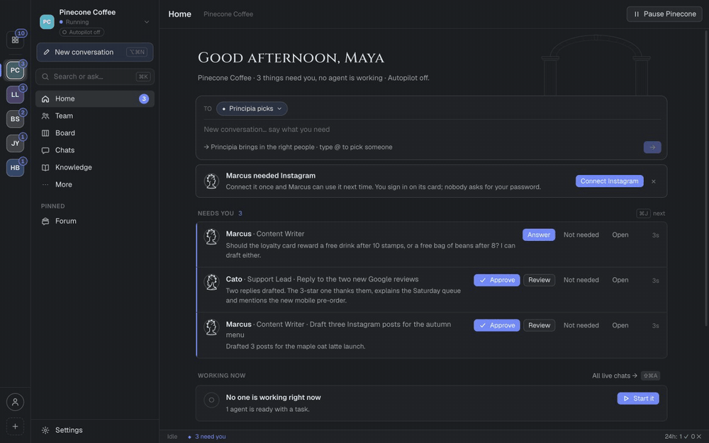

<p align="center">
  <picture>
    <source media="(prefers-color-scheme: dark)" srcset="resources/brand/banner-dark.png">
    <source media="(prefers-color-scheme: light)" srcset="resources/brand/banner-light.png">
    
  </picture>
</p>

# Principia

**Run your entire company. From one workspace.**

Principia is a Mac app where your AI agents work like a team. Claude Code, Codex and other coding CLIs share the same company tools, memory and workflows, hand work to each other without losing context, and run on your Mac or on a self-hosted cloud worker. You set the direction and approve what matters; the agents carry the work.

[](https://github.com/Vibiz-ai/principia/releases/latest)
[](LICENSE)
[](https://github.com/Vibiz-ai/principia/stargazers)
[](https://scorecard.dev/viewer/?uri=github.com/Vibiz-ai/principia)

[Download for Mac](https://github.com/Vibiz-ai/principia/releases/latest/download/Principia-arm64.dmg) · [Website](https://useprincipia.com) · [Quick start](#desktop-quick-start) · [Contribute](CONTRIBUTING.md) · [Cloud setup](cloud/README.md) · [Report a vulnerability](SECURITY.md)

<!-- DEMO_GIF: 45 s recording on the synthetic demo data (scripts/seed-demo.mjs). Keep it under 10 MB so it loads on GitHub. -->


*Recorded on sample data from `scripts/seed-demo.mjs` with a stand-in agent, so no model ran. Stills: [agents](website/public/principia-agents.png), [the workflow canvas](website/public/principia-canvas.png) and [the connection catalog](website/public/principia-connections.png).*

## Who it is for

Founders and small teams who already use Claude Code or Codex and are tired of repeating context, reconnecting the same services in every tool and checking on runs by hand. Principia gives those agents one shared place to work.

This is an early open-source release. The desktop app targets Apple Silicon Macs. The cloud runner is experimental and meant for one trusted operator, not a public multi-tenant service.

## Desktop quick start

You can be up and running in a few minutes:

1. **Download** [Principia for Mac](https://github.com/Vibiz-ai/principia/releases/latest/download/Principia-arm64.dmg) (Apple Silicon, macOS 13 Ventura or later) and drag it to Applications. Builds are signed and notarized by Apple and update themselves. [Release notes and checksums](https://github.com/Vibiz-ai/principia/releases/latest).
2. **Install and sign in to one agent CLI**, such as Claude Code or Codex. Principia uses your own CLI login; it never asks for that account's password. Workflows that use GitHub also need `gh auth login`.
3. **Open Principia**, choose a project folder and start a session. Connect your company tools once under **Settings → Connections** and every agent can use them.

If Principia is useful to you, a ⭐ on this repo helps other people find it.

### Build from source

Requirements: Apple Silicon macOS, Node.js 24 and at least one installed agent CLI.

```sh
npm ci
npm run dev
```

Use isolated data for development:

```sh
HIVE_USER_DATA=/tmp/principia-dev HIVE_NO_SCHEDULER=1 npm run dev
```

Build the desktop package:

```sh
npm run build
npm run dist
```

`npm run dist` makes an unsigned local package. Signed, notarized releases with automatic updates are made with `npm run release:mac`: see [Releasing](docs/RELEASING.md). Internal `HIVE_*` variables, `.hive.json` workflow files, data paths and some identifiers remain for compatibility with the earlier Hive prototype. Existing local data is not renamed or uploaded by this release.

## What works today

- **Agent sessions:** terminal panes for installed coding CLIs, with Claude ↔ Codex handoffs carrying available conversation context and recent output.
- **Workflows:** agent, shell, reviewer, room, wait and notification nodes; local scheduling and run history. Usage-limit failures can try other installed harnesses.
- **Shared MCP connections:** configure stdio or Streamable HTTP tool servers once in Principia for Claude and Codex, scoped to selected project folders or all projects. Desktop credentials are encrypted. Remote services can use managed browser OAuth sign-in, including Mobbin.
- **Memory:** project knowledge and provenance with review/edit controls. Provider support varies; brief injection is used where direct memory MCP support remains unverified.
- **Artifacts and visibility:** outputs, live agent activity, a workflow editor and a canvas with an expandable parent/subagent hierarchy alongside the workflow execution view.
- **Cloud and phone control:** a self-hosted Linux container with an authenticated API, persistent job/run storage, CLI execution, workflow import and optional Telegram control.

## Where it is going

The ambition is a workspace for operating one company or a thousand, with agents carrying work from start to finish and people setting the direction. Today’s preview provides the execution foundation: agents, shared MCP connections, workflows, schedules, and project memory. Full multi-company administration and autonomous operation at that scale remain roadmap work.

**Passport** is the name for the portable company memory we’re building toward: company identity, knowledge, decisions, and working context that can be imported into a workspace or selectively shared with compatible services alongside sign-in. Project memory exists today; Passport import/export and sign-in integration are planned.

<p align="center">
  <picture>
    <source media="(prefers-color-scheme: dark)" srcset="resources/brand/scribe-dark.png">
    <source media="(prefers-color-scheme: light)" srcset="resources/brand/scribe-light.png">
    
  </picture>
</p>

The broader company toolbox is intended to cover databases, image generation, web research and scraping, connections, phone, and email. Compatible MCP tools can be connected today; dedicated setup for these categories is on the roadmap.

## Connect company tools once

Open **Settings → Connections → Company connections**. Choose **Connect Mobbin** or **Add connection**, enter a server URL, and select the projects allowed to use it or choose All projects. Sign in through your browser, or choose an API key/local server configuration. New Claude and Codex sessions and workflow steps receive a Principia bridge automatically.

Principia owns the connection; harness account logins remain separate. The gateway currently proxies tools, not MCP resources, prompts or sampling. It preserves harness approval policies. Read [MCP setup and permissions](docs/MCP-GATEWAY.md).

## Run from your phone

**iPhone app.** A native app watches your agents and keeps the work going from your phone: pair it with Principia on your Mac (Settings › App › Phone), or try a sample company without a Mac. Public TestFlight link: coming soon. <!-- TESTFLIGHT_LINK: replace "coming soon" with the public link (https://testflight.apple.com/join/…) once the first build is approved; docs/IOS.md, TestFlight --> Build it yourself: [docs/IOS.md](docs/IOS.md).

**Self-hosted worker.** Deploy the worker on an always-on Linux server with Docker, persistent storage and agent CLIs authenticated in that environment. Telegram long polling receives your commands without exposing a public webhook.

```sh
cp cloud/.env.example cloud/.env
# Configure a random PRINCIPIA_API_TOKEN and optional Telegram credentials/allowlists.
docker compose -f cloud/compose.yml up -d --build
```

Agent login and repository checkout are separate setup steps. The desktop Keychain cannot be copied to a Linux container. Read [cloud deployment and phone setup](cloud/README.md), including permissions, authentication and workflow limits, before starting a live worker.

This repository ships deployment configuration; it does not include a hosted account or preconfigured live bot.

## Marketplace

Browse **Marketplace** in the desktop sidebar for reusable workflows, skills, scripts and agents. Search by task or use case, inspect what an item does, then install it. Workflows open as editable copies; installation does not start a run. Skills and subagents currently install for Claude Code. You can also add an HTTPS community catalog in Settings → Data.

Want to share a company capability? See the [Marketplace contribution guide](resources/marketplace/README.md).

## Contribute

We’d love your help, and first-time contributors are very welcome. Good places to start:

- [Good first issues](https://github.com/Vibiz-ai/principia/issues?q=is%3Aissue+is%3Aopen+label%3A%22good+first+issue%22): small, scoped changes with the files and checks named.
- [Help wanted](https://github.com/Vibiz-ai/principia/issues?q=is%3Aissue+is%3Aopen+label%3A%22help+wanted%22): reproducible bugs, harness compatibility, accessible UI and cloud execution.
- A reusable workflow or skill for the [Marketplace](resources/marketplace/README.md).
- Questions and ideas: [Discussions](https://github.com/Vibiz-ai/principia/discussions).

Read [CONTRIBUTING.md](CONTRIBUTING.md) before your first pull request.

```sh
npm run typecheck
npm run lint
npm test
npm run build
npm run cloud:build
npm run cloud:test
npm run release:test
```

Some native database tests need an appropriate Node/Electron ABI. See the contribution guide and cloud smoke command for verification details.

## Architecture

<p align="center">
  <picture>
    <source media="(prefers-color-scheme: dark)" srcset="resources/brand/aqueduct-dark.png">
    <source media="(prefers-color-scheme: light)" srcset="resources/brand/aqueduct-light.png">
    
  </picture>
</p>

| Directory | Purpose |
| --- | --- |
| `src/main/engine` | Shared workflow execution, provider adapters, retries and scheduling |
| `src/main/gateway` | Desktop MCP broker, scoped grants and stdio bridge |
| `src/main/sessions.ts` | Desktop interactive PTY sessions |
| `src/renderer` | React desktop interface |
| `src/cloud` | Headless adapter for the shared workflow engine |
| `website` | React + TypeScript + Tailwind install and product page |
| `cloud` | Cloud API, prompt runner, Telegram control and containers |
| `src/shared` | Domain types and IPC contracts |

The desktop renderer is sandboxed, uses typed IPC and has no production network listener. Agent CLIs and connected tools communicate with their providers. The cloud worker is a separate authenticated server; run it in an isolated environment with only the repositories and credentials it needs. Project folder scopes are application access controls, not an operating-system sandbox for arbitrary code.

## License

[MIT](LICENSE).
