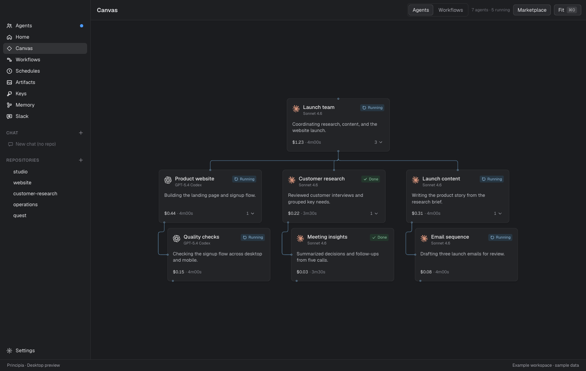

# Principia

[Website](https://principia-vibiz-deployments.vercel.app) · [GitHub](https://github.com/Vibiz-ai/principia) · [Contribute](CONTRIBUTING.md) · [Cloud setup](cloud/README.md) · [Report a vulnerability](SECURITY.md)

**Run your entire company. From one workspace.**

Principia brings agent sessions, company tool connections, memory, workflows and schedules together. Use Claude Code and Codex in the same workspace, keep context when changing harnesses, and run work on your Mac or a self-hosted cloud worker.

This is an early open-source release. The desktop app targets Apple Silicon macOS. The cloud runner is experimental and intended for one trusted operator, not a public multi-tenant service.



*Current interface with sample data. [Explore the connection catalog](website/public/principia-connections.png).*

## What works today

- **Agent sessions:** terminal panes for installed coding CLIs, with Claude ↔ Codex handoffs carrying available conversation context and recent output.
- **Workflows:** agent, shell, reviewer, room, wait and notification nodes; local scheduling and run history. Usage-limit failures can try other installed harnesses.
- **Shared MCP connections:** configure stdio or Streamable HTTP tool servers once in Principia for Claude and Codex, scoped to selected project folders or all projects. Desktop credentials are encrypted. Remote services can use managed browser OAuth sign-in, including Mobbin.
- **Memory:** project knowledge and provenance with review/edit controls. Provider support varies; brief injection is used where direct memory MCP support remains unverified.
- **Artifacts and visibility:** outputs, live agent activity, a workflow editor and a canvas with an expandable parent/subagent hierarchy alongside the workflow execution view.
- **Cloud and phone control:** a self-hosted Linux container with an authenticated API, persistent job/run storage, CLI execution, workflow import and optional Telegram control.

The ambition is a workspace for operating one company or a thousand, with agents carrying work from start to finish and people setting the direction. Today’s preview provides the execution foundation: agents, shared MCP connections, workflows, schedules, and project memory. Full multi-company administration and autonomous operation at that scale remain roadmap work.

**Passport** is the name for the portable company memory we’re building toward: company identity, knowledge, decisions, and working context that can be imported into a workspace or selectively shared with compatible services alongside sign-in. Project memory exists today; Passport import/export and sign-in integration are planned.

The broader company toolbox is intended to cover databases, image generation, web research and scraping, connections, phone, and email. Compatible MCP tools can be connected today; dedicated setup for these categories is on the roadmap.

## Desktop quick start

Requirements: Apple Silicon macOS, Node.js 24 and at least one installed agent CLI. Authenticate that CLI separately with your account. Workflows using GitHub CLI also need `gh auth login`.

```sh
npm ci
npm run dev
```

Use isolated data for development:

```sh
HIVE_USER_DATA=/tmp/principia-dev HIVE_NO_SCHEDULER=1 npm run dev
```

Build the desktop package:

```sh
npm run build
npm run dist
```

macOS packages are currently unsigned. Internal `HIVE_*` variables, `.hive.json` workflow files, data paths and some identifiers remain for compatibility with the earlier Hive prototype. Existing local data is not renamed or uploaded by this release.

## Connect company tools once

Open **Settings → Connections → Company connections**. Choose **Connect Mobbin** or **Add connection**, enter a server URL, and select the projects allowed to use it or choose All projects. Sign in through your browser, or choose an API key/local server configuration. New Claude and Codex sessions and workflow steps receive a Principia bridge automatically.

Principia owns the connection; harness account logins remain separate. The gateway currently proxies tools, not MCP resources, prompts or sampling. It preserves harness approval policies. Read [MCP setup and permissions](docs/MCP-GATEWAY.md).

## Run from your phone

Deploy the worker on an always-on Linux server with Docker, persistent storage and agent CLIs authenticated in that environment. Telegram long polling receives your commands without exposing a public webhook.

```sh
cp cloud/.env.example cloud/.env
# Configure a random PRINCIPIA_API_TOKEN and optional Telegram credentials/allowlists.
docker compose -f cloud/compose.yml up -d --build
```

Agent login and repository checkout are separate setup steps. The desktop Keychain cannot be copied to a Linux container. Read [cloud deployment and phone setup](cloud/README.md), including permissions, authentication and workflow limits, before starting a live worker.

This repository ships deployment configuration; it does not include a hosted account or preconfigured live bot.

## Contribute

We welcome reproducible bug reports, harness compatibility fixes, accessible UI improvements, reusable workflow examples and help with cloud execution. Read [CONTRIBUTING.md](CONTRIBUTING.md).

```sh
npm run typecheck
npm test
npm run build
npm run cloud:build
npm run cloud:test
npm run release:test
```

Some native database tests need an appropriate Node/Electron ABI. See the contribution guide and cloud smoke command for verification details.

## Architecture

| Directory | Purpose |
| --- | --- |
| `src/main/engine` | Shared workflow execution, provider adapters, retries and scheduling |
| `src/main/gateway` | Desktop MCP broker, scoped grants and stdio bridge |
| `src/main/sessions.ts` | Desktop interactive PTY sessions |
| `src/renderer` | React desktop interface |
| `src/cloud` | Headless adapter for the shared workflow engine |
| `website` | React + TypeScript + Tailwind install and product page |
| `cloud` | Cloud API, prompt runner, Telegram control and containers |
| `src/shared` | Domain types and IPC contracts |

The desktop renderer is sandboxed, uses typed IPC and has no production network listener. Agent CLIs and connected tools communicate with their providers. The cloud worker is a separate authenticated server; run it in an isolated environment with only the repositories and credentials it needs. Project folder scopes are application access controls, not an operating-system sandbox for arbitrary code.

## License

[MIT](LICENSE).
